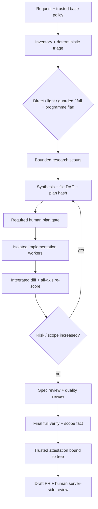

# RiskRails v4 — архитектура и план от нулата

Дата: 2026-10-31. Статус: design proposal, без имплементация. Автор: Astra; изследване: FAST scouts. Източник на задачата: `docs/research/riskrails-v4-design-prompt.md`. Името `reasarch-astra.md` е запазено по заявката на собственика.

Обозначения: **[V]** проверено в посочения първоизточник; **[U]** непотвърдено; **[D]** проектно решение; **[H]** хипотеза/цел за измерване. Документацията по `main` и runtime capabilities изискват pinning и conformance tests преди реална поддръжка. Числата за бъдещия продукт са бюджети и acceptance targets, а не измерени резултати.

## 1. Позициониране

**[D] RiskRails е project risk engine, който превръща измерими правила в изпълними ограничения и проверими доказателства за една промяна.** Основните му продукти са risk decision, capability plan и closure attestation. Поддържа чужди spec и implementation методологии през стабилни contracts.

Двата предложени диференциатора са: детерминистичен triage с повторно измерване на реалния diff; compiler от project policy към runtime permissions, sandbox и server-side gates. **[U] Не е доказано, че никой конкурент няма тези функции.** Ограниченото проучване не оправдава пазарното „единствен“. Използваме „централни възможности на RiskRails“, докато няма възпроизводим сравнителен тест с pinned версии.

OpenSpec може да управлява lifecycle на specs; Superpowers-style implementer/spec-review/quality-review е заменим протокол; Addy предоставя конкретни skills. RiskRails не пише нов IDE, LLM proxy, универсален workflow language, package manager или собствен kernel sandbox. Няма миграционен engine за целия v3, нито автоматично съхраняване на alias командите му.

Локалните основания са конкретни: v3 измерва шест оси и запазва двата факта, но повторно оценява само domain/reversibility; непокритите случаи и ограниченията на regex guards са признати. Виж [weight](../../../claude-agentic/docs/weight.md), [roadmap](../../../claude-agentic/ROADMAP.md), [known risks](../../../claude-agentic/docs/known-risks.md). Пътищата са към съседния checkout, не част от v4 deliverable.

## 2. Архитектура и жизнен цикъл

**[D] Един Go executable `rr`, вътрешно разделен на чист decision core и адаптери.** CLI, MCP и hooks извикват същия core. Enforcement се изпълнява от доверен supervisor/CI извън writable workspace. Самостоятелно пуснатият локален CLI дава полезни проверки, но няма право да се представя като security boundary срещу процес със същите OS права.

| Компонент | Отговорност и contract |
|---|---|
| policy | strict parsing, canonical hash, сравнение base/candidate, компилация на capabilities |
| risk | `Assess(snapshot, policy, declarations) → Decision + evidence`; без LLM и network |
| availability/router | entitlement observations, effective ladder, budgets, role routing |
| planner/factory | validated DAG, leases върху файлове, scheduler, bounded workers |
| evidence/verify | change inventory, test selection, trusted execution, attestations |
| supervisor | credentials broker, sandbox launcher, kill switch, approvals, journal writer |
| adapters | runtime/tool/test/release interfaces; generated manifests |
| ledger | tokens/cost/time, provenance, compact task record |



Direct/light може да пропусне D и F според policy; винаги минава през inventory, re-score и двата факта. Programme е размер на orchestration, а не отделна скала, която може да замести full. Всички transitions са идемпотентни по task ID + transition ID; event intent се записва преди side effect, после result. Crash между двете води до reconciliation, не до сляпо повторение.

**Двата факта:** (1) успешен задължителен пълен verify върху конкретен immutable tree; (2) целият diff е в одобрения scope. Attestation включва base/head/tree, untracked inventory, policy hash, plan hash, verify recipe digest, environment/image digest и suite report digest. Всяка последваща промяна обезсилва attestation. Scope включва deletions, rename source/destination, symlinks, submodule pointers, file modes и generated files; ignored/untracked файлове също се инвентаризират или workspace се материализира наново в чиста изолация.

При server-side приемане е задължителна merge queue или еквивалентен атомарен gate: trusted full verify се изпълнява върху конкретния интегриран merge candidate срещу текущия protected branch. Attestation само за PR head не е достатъчна. Промяна на target/base обезсилва candidate attestation; queue rebuild-ва и проверява новото дърво. Gate приема само точно проверения candidate, ако target още съвпада. Локалното task close е отделно от server-side merge eligibility.

## 3. Един `riskrails.yaml`: схема, пример и защита

**[D] YAML 1.2 подмножество, strict JSON Schema 2020-12 като генериран артефакт.** Без custom tags, merge keys, duplicate keys, environment interpolation, includes или executable expressions. Неизвестен key/версия е error. Проектната политика е в един файл; наблюдения, credentials и approval receipts са runtime state извън него.

Следният пример определя пълната v1 конфигурационна повърхност. Конкретните model IDs са примерни allowlist записи, не твърдение за достъп; installer предлага само наблюдаваните кандидати. Empty runtime map е валиден и означава, че runtime-ът е изключен.

```yaml
schema_version: 1
project: symfony-commerce
risk:
  axes: # score 0..2; detector IDs са в подписания engine, не скриптове от repo
    scope:         {weight: 1, detector: reference_fanout, unknown: 1}
    behaviour:     {weight: 1, detector: behaviour_change, unknown: 1}
    reversibility: {weight: 2, detector: persistent_effects, unknown: 2}
    domain:        {weight: 2, detector: sensitive_domain, unknown: 2}
    novelty:       {weight: 1, detector: dependency_and_pattern, unknown: 1}
    coverage:      {weight: 1, detector: coverage_evidence, unknown: 2}
  thresholds: {light_max: 2, guarded_max: 7} # full: >7 или hard floor
  scope_bands: {references_low_max: 0, references_medium_max: 5}
  critical_paths:
    identity: [src/Security/**, config/packages/security.yaml]
    money: [src/Payment/**, src/Tax/**]
    data: [migrations/**, src/Entity/**]
  floors:
    - {when: critical_paths.identity, axis: domain, min: 2, mode: full}
    - {when: critical_paths.money, axis: domain, min: 2, mode: full}
    - {when: critical_paths.data, axis: reversibility, min: 2, mode: full}
    - {when: policy_change, mode: full}
    - {when: security_control_change, mode: full}
  direct: {max_score: 0, paths: [docs/content/**], max_files: 2}
  programme: {min_steps: 8, min_components: 3} # OR; всеки child има собствен risk
  rescore: {all_axes: true, monotonic: true}
models:
  allowed_tiers: [FAST, BALANCED, STRONG, EXPERT]
  runtimes:
    codex:
      FAST: [{id: gpt-6-luna, effort: low}]
      BALANCED: [{id: gpt-6.1-sol, effort: medium}]
      STRONG: [{id: gpt-6.1-sol, effort: high}]
      EXPERT: [{id: gpt-6-astra, effort: high}]
    claude:
      FAST: [{id: haiku, effort: low}]
      BALANCED: [{id: sonnet, effort: medium}]
      STRONG: [{id: opus, effort: high}]
      EXPERT: [] # никой модел не се подразбира
    gemini: {}
    cursor: {}
    kiro: {}
    copilot: {}
    opencode: {}
    goose: {}
  fallback:
    FAST: []
    BALANCED: [FAST]
    STRONG: [BALANCED]
    EXPERT: [STRONG, BALANCED]
  role_minimum: {scout: FAST, implementer: BALANCED, full_reviewer: STRONG}
  availability: {positive_ttl_seconds: 300, negative_ttl_seconds: 60,
                 unknown: deny, max_probe_requests: 2}
  budgets:
    light: {total_tokens: 20000, research_tokens: 2000}
    guarded: {total_tokens: 70000, research_tokens: 10000}
    full: {total_tokens: 160000, research_tokens: 24000}
    programme: {total_tokens: 500000, research_tokens: 40000}
    max_parallel_workers: 3
    max_turns_per_worker: 12
    max_review_rounds: 2
    max_inflight_reserved_tokens: 48000
    enforcement: strict # strict изисква контрол преди всяка model request; иначе отказ
autonomy:
  ceiling: L3
  max_by_risk: {direct: L4, light: L3, guarded: L2, full: L1}
  output: draft_pr
  human_gates: [full_plan, policy_change, merge, release]
  kill_switch: {required: true, lease_seconds: 30, offline: stop}
enforcement:
  require_isolation_from: L2
  protected_paths: [riskrails.yaml, .github/**, .codex/**, .claude/**,
                    .gemini/**, AGENTS.md, scripts/verify/**]
  egress: {default: deny, read_hosts: [symfony.com, www.php.net],
           mcp_servers: []}
  commands:
    inspect: {argv: [git, diff, --no-ext-diff], network: false}
    phpunit: {argv: [vendor/bin/phpunit], network: false}
    phpstan: {argv: [vendor/bin/phpstan, analyse, --no-progress], network: false}
    composer_validate: {argv: [composer, validate, --strict], network: false}
  unknown_command: deny
  shell: {parser: posix_ast, opaque_execution: isolated_only}
verify:
  adapters: [phpunit, phpstan, composer]
  full: [composer_validate, phpstan, phpunit]
  selected: {enabled: true, strategy: coverage_graph, shadow_fraction: 0.1}
  full_on: [lockfile, config, ci, migrations, unknown_impact, high_risk,
            stale_coverage, adapter_failure, test_deletion]
  full_at_close: true
  nightly_full: true
  coverage_max_age_hours: 24
release:
  ecosystem: composer
  channel: stable
  executor: ci_only
  credential_mode: oidc_broker # Packagist няма предположен native OIDC
  destination: packagist
  protected_environment: release
  require_human: true
research:
  scouts:
    light: [code]
    guarded: [code, project_docs, tech_docs, prior_art]
    full: [code, project_docs, tech_docs, prior_art, risk_history, tests]
    programme: [code, project_docs, tech_docs, prior_art, risk_history, tests]
  conditional: {tech_docs: changed_dependency_or_api,
                prior_art: new_mechanism, light: unresolved_question}
  max_parallel: 3
  max_total_scouts: {light: 1, guarded: 4, full: 6, programme: 8}
  output_tokens_per_scout: 800
  cache: {enabled: true, remote_max_age_hours: 24}
  external_queries: sanitized_only
```

Нормативни ограничения: всички показани top-level sections са задължителни; nested keys също, освен runtime tier entries, които може да липсват. `axes` е точно изброеният набор; weight е integer 1–10, unknown е 0–2; thresholds са integer и `0 ≤ light_max < guarded_max ≤ 2Σweights`. Floor selectors са predefined IDs или съществуващ critical-path group; axis/min са заедно, mode е light/guarded/full. Glob-овете са repo-relative POSIX, без `..`, абсолютни пътища или escaping; `**` има една семантика във всички адаптери. Всички budgets/TTL/лимити са positive integers, fraction е 0–1. L0–L4 и tier имената са closed enums. Model IDs са opaque strings; effort е low/medium/high и се валидира срещу capability на runtime. Fallback графът е acyclic, няма повторения и не заобикаля role minimum. Runtime, detector, adapter, condition и ecosystem IDs са closed registry на версията на engine; неизвестен ID блокира. Command argv е nonempty string array, без shell interpolation; `verify.full` сочи само регистрирани commands. `credential_mode` е `native_oidc|oidc_broker|disabled`; липсващ broker блокира release. Schema е contract за P0; този документ не твърди, че JSON Schema вече е генерирана.

Оценката е `score_i = max(measured_i, declared_i, floor_i)`; `W = Σ(weight_i × score_i)`. UNKNOWN остава видим и използва policy default, никога мълчаливо нула. Path/text/static detectors дават долна граница, а не доказателство за пълна семантична оценка. Hard floors имат предимство. Нов файл, Markdown файл, тест или dependency update не получава автоматично нулев domain: docs могат да са инструкции, tests/CI могат да изключат защитите. Programme се активира при ≥8 стъпки ИЛИ ≥3 компонента; child risk и aggregate full floor се запазват. Повторното измерване е след всеки integrated batch, преди capability grant и при close; режимът само се покачва.

### Precedence и policy self-protection

**[D] Effective permissions = platform constraints ∩ enterprise ceilings ∩ trusted project policy ∩ task scope ∩ user restrictions.** При risk floors се взима максимумът, при budgets/автономия — минимумът. User настройки могат да избират preferred runtime и да намаляват права, но не да разширяват. Това е семантика на RiskRails; native config merge order не се приема за еднакъв между продуктите.

Claude има managed restrictions; Codex отделя config defaults от admin requirements; Kiro steering precedence е guidance, не security. [Claude managed settings](https://support.claude.com/en/articles/14128775-claude-code-on-console-to-enterprise-migration), [Codex configuration](https://learn.chatgpt.com/docs/config-file/config-basic), [Kiro steering](https://kiro.dev/docs/steering/).

При start supervisor взима policy от одобрената protected branch и пази hash извън workspace. Candidate policy в PR никога не определя как самата тя се проверява. Conservative v1: **всяка** промяна на policy/control plane е full, дори уж затягаща. Semantic diff изписва relaxation: намалени weights/floors/unknown scores, увеличени thresholds/budgets/autonomy, разширени модели/egress/команди, отслабен verify/review, нови exemptions. Неясно сравнение е relaxation. Новата политика действа едва в нова задача след човешко одобрение и merge; текущата остава pinned.

CODEOWNERS пази `riskrails.yaml`, себе си, CI workflows, verifier, generators и runtime configs. Server-side ruleset изисква human code-owner review, dismiss stale approvals, checks от доверен App и липса на bypass за bot/runner. Един owner може да е достатъчен според GitHub, затова списъкът не съдържа agent identity. [GitHub CODEOWNERS](https://docs.github.com/en/repositories/managing-your-repositorys-settings-and-features/customizing-your-repository/about-code-owners).

CODEOWNERS сам по себе си не е gate. CI използва verifier/image от trusted control plane, не PR-modified workflow или script. Agent token е ограничен до task branch/draft PR, без approvals, merge, ruleset/settings и release permissions. Human receipt е server-side identity + repository + action + expiry + nonce и action-specific binding; текст „approved“, PTY или local JSON не е receipt. Plan-execution receipt се връзва към base, policy, plan и scope: допуска последващите in-scope implementation revisions, но става невалиден при промяна на тези bindings или ескалация на риска. Merge/release receipt се връзва към точния финален candidate/artifact digest; нова ревизия или target/base го обезсилва. Администратор с bypass остава извън гаранцията; `doctor` докладва тази граница.

## 4. Model availability resolver

**[V] Catalog ≠ entitlement.** Claude aliases зависят от provider/account, Cursor selection зависи и от plan/admin ограничения, OpenCode catalog/config не доказва успешно изпълнение. [Claude models](https://code.claude.com/docs/en/model-config), [Cursor models](https://prod.cursor.com/help/models-and-usage/available-models), [OpenCode models](https://docs.opencode.ai/docs/models/).

**[D] Алгоритъм:**

1. Runtime adapter събира version, account fingerprint без credentials, endpoint, auth mode и capability evidence. Само local metadata/advertised session capabilities първо; не scrape-ва UI и не предполага API entitlement от ChatGPT/Claude subscription.
2. Прави candidate intersection с project allowlist. Resolved alias се записва с version/time; неизвестен alias target не получава production grant.
3. За неизвестен кандидат предпочита authenticated metadata/entitlement endpoint. Ако няма такъв, допуска до 2 изрично бюджетирани минимални probe requests без repo content и без tools; probe не е task dispatch. Ако probes не са разрешени или API auth липсва, резултатът е UNKNOWN и кандидатът се изключва.
4. Cache key: account fingerprint + provider endpoint + runtime/version + model/resolved alias + capability/effort. Positive TTL 300 s, negative 60 s; квота с retry-after има собствен expiry. Cache е извън agent-writable workspace; revoke/account/config changes го инвалидизират.
5. `effective = allowed ∩ observed_available ∩ compatible`. Ladder се филтрира преди UI и dispatch. EXPERT → STRONG е допустимо само ако STRONG е effective и role minimum позволява. Full reviewer без STRONG чака човек; не се маскира BALANCED като STRONG. Ако FAST липсва, scout не се качва автоматично на скъп модел: използва deterministic retrieval или спира тази research стъпка.
6. Supervisor резервира token/turn budget атомарно преди launch. Hard token enforcement допълнително изисква capability `request_budget_enforcement`, която сертифицира admission преди всяка model request, включително вътрешни retries и reasoning/context allowance. `models.budgets.enforcement` е enum `strict|estimated`: strict отказва runtime без тази capability; estimated използва soft token estimate и enforceable time/turn ceilings. Няма migration на главната сесия само за една роля; ескалацията е в отделен worker.
7. При runtime error: 401 спира account adapter; 403/revoked entitlement и model-not-found изключват конкретния кандидат; 400 invalid payload не означава недостъпен модел; 429 invalidates quota readiness, уважава retry-after и общия account pool; 5xx има най-много един bounded retry. Неуспешен thinking резултат не се retry-ва на по-евтин модел. Availability failure преди работа може да използва одобрения fallback. Ако има частични side effects, първо reconciliation.

**Гаранция:** никога не се предлага или dispatch-ва модел, за който resolver знае, че е unavailable, или който е UNKNOWN. Не може честно да се гарантира нулева отхвърлена заявка: достъпът може да бъде отнет между probe и dispatch, а самият probe може да бъде отказан. Testable invariant е fail-closed dispatch с bounded staleness, незабавна invalidation и без повторно изискване на известен unavailable модел. Fable не присъства никъде по подразбиране.

## 5. Research factory за spec и plan

| Role | Въпрос | Доказателство |
|---|---|---|
| code-scout | Кой път изпълнява поведението и кой го вика? | file:line + commit/blob hash |
| project-docs-scout | Какво вече е решено? | README/ADR/spec със статус и противоречия |
| tech-docs-scout | Как работи точно инсталираната версия? | lock entry + official version/tag/source |
| prior-art-scout | Може ли да използваме готов механизъм? | local helper → dependency → OSS; compatibility/license |
| risk/history-scout | Какво вече се е проваляло? | trusted journal/incident/ADR references |
| test-scout | Кои проверки доказват промяната? | coverage/dependency graph + unknowns |

Direct: 0 scouts. Light: 0 по подразбиране, 1 code scout само при unresolved question. Guarded: до 4; tech/prior-art се пускат условно. Full: 6. Programme: 6 shared scouts + до 2 component scouts общо, не шест за всяка стъпка. Максимум 3 активни в примерната policy. Scout е FAST/low, read-only, без secrets и без transitive spawn; turns и total input/output са бюджетирани, не само финалното резюме.

Structured result v1: `{question_id, scope, source_revision, facts:[{claim, source, locator, version, verified_at, status:V|U}], reuse_candidates, contradictions, gaps, tokens}`. User-facing projection е FACTS/STEAL/AVOID/GAPS, до 500 думи; максимум 800 output tokens. Claim без locator е U. Orchestrator дедупликира по normalized source + version + claim hash; semantic disagreement не се изтрива като duplicate.

Research cache key включва commit SHA **и** dirty tree digest, lockfile hashes, query, role/prompt version, policy hash, adapter version и source version/TTL. Commit SHA сам не е достатъчен. Content hashes позволяват reuse между commits за непокътнати файлове. Отдалечени docs се revalidate-ват; cached summary е untrusted evidence, не инструкция.

Version resolver: `composer.lock` packages/packages-dev version + source.reference; package-lock packages entries, workspace links и integrity; uv.lock package version/source + markers; Cargo.lock name/version/source/checksum; за Go — `go.mod`, `go.work`, replacements и selected build list, не само `go.sum`. Не се download-ват или изпълняват зависимости при research. При липса на локален resolved graph се записва gap. Точната инсталирана source версия е последната проверка, ако docs са само major/minor. Context7/DeepWiki/DevDocs/llms.txt са retrieval слой, а не доказателство за exact version. [Context7 ingestion](https://context7.com/docs/api-reference/add-library/add-an-llmstxt-file), [DeepWiki](https://deepwiki.org/), [DevDocs](https://devdocs.io/about).

Reuse search започва с `rg`, следва AST/LSP, после installed dependencies и едва тогава OSS. Кандидатът трябва да има API/version compatibility, license compatibility, maintenance/security evidence и малък proof test. Popularity не доказва годност; code snippets не се копират без проверка. Външните заявки не съдържат proprietary код. [ast-grep](https://github.com/ast-grep/ast-grep), [Serena](https://oraios.github.io/serena/02-usage/030_clients), [jscpd](https://github.com/kucherenko/jscpd), [Sourcegraph](https://sourcegraph.com/docs/code-search).

Силният модел получава само bounded findings и спорните excerpts, прави requirements→evidence→decision→test mapping и записва rejected options. Втора вълна: максимум 4 тесни въпроса, само ако gap променя решение. Ако няма доказателство, препоръката се маркира D/U. GSD е полезен пример за research→plan→checker, без да възприемаме автоматично цялата му методология. [GSD workflow](https://github.com/gsd-build/get-shit-done/blob/main/get-shit-done/workflows/plan-phase.md).

## 6. Implementation factory

Task plan е DAG от `{id, requires, read_set, write_set, contract, tests, rollback, risk, budget}`. Deterministic validator проверява cycles, dependency references и file ownership. Паралелна работа се допуска само при непресичащи се canonical write sets и без нерешен read/write dependency; различни файлове могат да променят един API и тогава имат explicit edge. Lockfile, общ config и generated indexes са serial resources.

Всеки worker има worktree и отделен container/microVM според capability profile. Worktree изолира Git промени, не OS права. Supervisor монтира само write-set writable, пази `.git`, hooks, policy, credentials и control state извън него. Shell AST е полезен за обяснение и fast rejection, но Python, interpreter, shell expansion и symlink атаки се спират от sandbox/proxy, не от parser. Неподдържан shell е deny или isolated opaque execution; няма regex security claim.

Fresh implementer получава contract и minimal context. Резултатът е DONE / DONE_WITH_CONCERNS / BLOCKED / NEEDS_CONTEXT + patch digest + tests + residual risks. Само trusted integrator прилага patch в integration tree след scope check; това не е merge към protected branch. След всяка вълна се re-score-ва integrated diff и се изпълняват step tests.

Review: първо spec compliance, после code quality/security. Guarded може да използва един независим reviewer с два последователни passes; full изисква STRONG за security-sensitive качество. Worker не е собствен reviewer. Максимум 2 review rounds, всички HIGH/BLOCKER находки в една fix batch. Ескалация след един неуспешен reasoning attempt или explicit uncertainty; без цикъл „още един евтин опит“. Missing qualifying tier → human checkpoint. Ledger брои всички retries, cancelled workers и synthesis calls.

## 7. Токен модел и измерване

**[V] Anthropic отчита ~15× спрямо chat interactions, а agents ~4× спрямо chat; това не е 15× спрямо single agent.** Публикуваният резултат е вътрешна research оценка и не доказва coding savings. [Anthropic multi-agent research](https://www.anthropic.com/research/multi-agent-research-system).

**[H] Начални planning envelopes, хиляди input+output tokens, включително повторен input:**

| Ниво | Research | Synthesis/plan | Implementation | Review | Verify/fixes | Общо / budget ceiling* |
|---|---:|---:|---:|---:|---:|---:|
| light | 0–2 | 1–2 | 3–8 | 0–2 | 1–4 | 5–18 / 20 |
| guarded | 4–10 | 3–7 | 12–25 | 5–12 | 3–10 | 27–64 / 70 |
| full | 12–24 | 8–18 | 25–55 | 12–30 | 8–25 | 65–152 / 160 |
| programme, 8 стъпки | 24–40 | 16–35 | 80–180 | 30–80 | 20–100 | 170–435 / 500 |

*Budget ceiling е hard само при сертифициран `request_budget_enforcement`; при estimated mode е soft цел. Това са предположения за bounded задачи, не обещание за всеки repo. Целият разход включва prompt prefixes и tool outputs; cached input се брои като tokens, но с реалната си цена. Programme не получава неограничен бюджет с увеличаване на стъпките. In-flight reservations предотвратяват двойно разпределяне на остатъка, но сами не контролират скритите заявки на CLI. При непрозрачен subscription runtime няма hard token или dollar cap: използваме измерими process duration/turn ограничения и soft estimates, или отказваме dispatch при strict policy. Provider reporting latency се отчита изрично; UNKNOWN usage не се превръща в нула.

| Мярка | Очакван ефект [H], не адитивен | Ledger експеримент |
|---|---|---|
| 1. Role→tier routing | 20–50% по-нисък API-equivalent cost | еднакъв corpus и success criteria |
| 2. Conditional scout fan-out | 20–60% по-малко research tokens при малки задачи | 0/1/4 scouts, resolved gaps |
| 3. Stable prefix caching | 20–70% по-нисък input cost при hits | cache read/write tokens и miss rate |
| 4. Content-addressed evidence cache | 30–80% по-малък повторен research | fresh vs warm task |
| 5. `rg`/AST/LSP преди LLM | 10–30% по-малък context | source bytes → model tokens |
| 6. Малки always-loaded instructions | 10–25% по-малък repeated input | prefix tokens × calls |
| 7. Bounded summaries/JIT excerpts | 15–40% по-малък coordinator input | input при равна correctness |
| 8. File DAG и dedup | 10–30% по-малко retry/conflict tokens | duplicate retrievals, conflicts |
| 9. TIA + compact failure reports | 5–20% по-малък tool-output input | test CPU/time и model tokens отделно |
| 10. Batch за offline analysis | 50% API batch discount там, където е приложим [V] | actual billed vs interactive |

Batch discount не важи автоматично за CLI subscription. Cache hits изискват съвпадащ prefix и provider условия; subagent не наследява магически parent cache. [Anthropic caching](https://platform.claude.com/docs/en/build-with-claude/prompt-caching), [Anthropic batch](https://platform.claude.com/docs/en/build-with-claude/batch-processing), [OpenAI Batch](https://developers.openai.com/api/docs/guides/batch).

Ledger записва task/phase/role/runtime/resolved model, input/output/reasoning/cache counts, estimates vs metered, price-table version, wall time, retry cause и quality outcome. Missing usage е unknown, не zero. API-equivalent cost и subscription quota са различни полета. P0 benchmark corpus: минимум 20 representative задачи, baseline single-agent и bounded factory, report median/p90 cost, success, escaped defects и time. Предварителен quality gate: нито един нов HIGH/BLOCKER escaped defect и не по-нисък task success върху paired corpus; 20 задачи са pilot, не статистическо доказателство за обща еквивалентност. При нарушение savings не се обявяват за успешна оптимизация.

## 8. Автономия и човешко одобрение

| Ниво | Допустима автономия | Default risk ceiling |
|---|---|---|
| L0 | read-only анализ, без patch | всеки риск |
| L1 | supervised patch/plan; човек разрешава full execution | full |
| L2 | изпълнение на одобрен scope/plan в изолация | guarded |
| L3 | сам избира bounded plan, tests и поправки → draft PR | light |
| L4 | scheduled queue, повече задачи, всяка → draft PR | direct по default |

Effective level е min(project ceiling, risk ceiling, runtime capabilities, enterprise ceiling, task request). Full unattended може да изготви plan/draft patch, но не преминава изисквания human plan gate. Нито L4 дава merge/deploy/publish право. Задължителното човешко одобрение е преди приемане в protected branch/release; нискорискова локална draft работа не изисква човек на всяка стъпка.

Runner има queue lease, immutable base policy, disposable execution environment, branch-only credential broker и explicit limits за duration, turns, tokens и external actions. Kill switch се проверява при dispatch и на 30-second lease; при revoke supervisor спира worker process group, revoke-ва capability/credential grants и прекратява egress. Offline след изтичането на lease е stop. Отдалечени операции, вече приети от service, не могат да бъдат върнати с kill switch: отделни idempotency keys и reconciliation са задължителни.

Append-only journal е писан само от supervisor, с sequence и hash chain, периодично anchor-нат към trusted storage. Локален JSONL, който агентът може да пренапише, е диагностичен mirror. Hash chain без външен anchor не предотвратява замяна на цялата история. Log failure блокира нови privileged actions. Journal пази decisions и digests, не secrets и пълни prompts.

## 9. Release, test impact и simplify

### Release adapter

Contract: `Detect → Prepare(version, channel) → Preflight → DryRun → Attest → CI Publish`. Връща artifact digest, destination, credential capability, rollback limitations и exit status. Agent подготвя changelog/version/metadata/PR; trusted CI получава OIDC identity след human environment approval. Artifact се строи в unprivileged job, signing/publish job консумира exact digest; PR-controlled code не се изпълнява с publish credentials.

Първи adapters: npm (`pack`, trusted publishing), PyPI (`build`, metadata checks, trusted publisher), Composer (`validate`, tag/Packagist integration), Go (tag/module release), Cargo (`package`/`publish --dry-run`), Docker/Helm OCI (build/lint/render, registry push от CI). Те се доставят поетапно, не всички в MVP.

OIDC се поддържа от конкретни registries/providers; няма общ „OIDC publish“ за всички екосистеми. npm има конкретни runner ограничения; Go release е tag/module lifecycle; Helm може да е OCI или chart repository. [npm trusted publishing](https://docs.npmjs.com/trusted-publishers/), [Go publishing](https://go.dev/doc/modules/publishing), [Cargo publishing](https://doc.rust-lang.org/cargo/reference/publishing.html), [Helm repositories](https://helm.sh/docs/topics/chart_repository/).

Ако native OIDC липсва: OIDC→trusted credential broker в CI или adapter остава `prepare_only`; не добавяме дългоживеещ credential при агента. За Composer примерът изисква отделно конфигуриран broker, не предполага такъв. Dry-run не доказва, че remote publish ще успее; publish receipt е отделно доказателство.

### Test impact adapter

Contract: `Select(change, coverage_revision, graph) → selected_tests + reasons + confidence`; `Run → normalized results`. Първи: PHPUnit coverage graph, Jest related tests и pytest-testmon; PHPStan/Composer checks остават общи. Coverage от друг environment/branch или missing edge е unknown. Full-on triggers от policy са задължителни.

TIA спестява intermediate runs, не заменя финалния пълен run: `full_at_close: true` запазва оригиналния първи факт. Nightly и 10% shadow full runs измерват `selection_misses = tasks with selected-pass/full-fail attributable to omission / sampled tasks`. Miss веднага изключва selection за засегнатия adapter/component, докато graph е поправен. Test deletion и отслабени assertions са review/risk сигнали; наличието на тест със сходно име не е coverage доказателство.

### Simplify skill

Един portable SKILL.md contract: inspect bounded diff → findings по reuse/clarity/efficiency → предложи patch → verify behaviour. За guarded/full могат да работят до 3 read-only scouts; light ползва един pass. Без нови dependencies, публичен API redesign, промяна на поведение или разширяване на write-set. Refactoring е отделен task, когато е извън текущия contract. Интерфейс `rr simplify --task ID --check` произвежда findings; apply изисква отделна одобрена scope стъпка. Работи чрез същия adapter в Claude/Codex/Gemini; няма обещание за идентичен вътрешен `/simplify` implementation.

## 10. Runtime матрица и degrade режими

| Runtime | Проверено/налична опора | Gap | RiskRails режим |
|---|---|---|---|
| Claude Code | permissions/managed restrictions; hook blocking | trust/setup/version; sandbox не е универсален за всички surfaces | certified hooks + external isolation за L2+ |
| Codex | source има PreToolUse deny; plugin hooks искат trust | client/version coverage; remote tools не са local sandbox | capability probe + pinned conformance; иначе advisory |
| Gemini CLI | extensions hooks/skills/policies; allow/deny/ask_user | docs предупреждават за nonfunctional workspace policy tier | trusted user/admin launch + isolation; не repo policy alone |
| Cursor | headless CLI потвърден | Claude hook compatibility/failClosed/headless hook gating U | advisory + external sandbox, L0/L1 без certification |
| Kiro | steering документиран | permissions enforcement не е потвърден тук | advisory, gated external runner |
| Copilot | PR workflow от входното проучване | native complete hook contract U | PR/CI integration; без local enforcement claim |
| OpenCode | provider/model config | entitlement и native guard completeness U | controlled runner + certified adapter |
| Goose + OpenRouter/LiteLLM | възможен transport за Llama и други модели | routing proxy не е enforcement boundary | explicit provider adapter, sandbox; иначе L0/L1 |

Codex primary source показва 12 config events: PreToolUse, PermissionRequest, PostToolUse, PreCompact, PostCompact, SessionStart, SessionEnd, UserPromptSubmit, SubagentStart, SubagentStop, Stop, Interrupt; dispatcher съдържа и model-request labels. **Това не е обещание за всяка инсталирана версия.** [Hook config](https://github.com/openai/codex/blob/main/codex-rs/config/src/hook_config.rs), [PreToolUse](https://github.com/openai/codex/blob/main/codex-rs/hooks/src/events/pre_tool_use.rs), [runtime](https://github.com/openai/codex/blob/main/codex-rs/core/src/hook_runtime.rs), [plugin trust](https://developers.openai.com/plugins/build/plugins).

Gemini extensions могат да носят policy и skills, но extension policy не може сама да auto-approve tools; workspace tier има документирано ограничение. [Extensions](https://geminicli.com/docs/extensions/reference/), [policy engine](https://geminicli.com/docs/reference/policy-engine/), [skills](https://geminicli.com/docs/cli/using-agent-skills/).

Remote MCP е отделен trust domain. Broker allowlist-ва server/tool/actions, network destination и identity; native shell sandbox не може да контролира отдалечения service. Общите OpenAI API MCP docs са архитектурна опора, не доказателство за конкретно Codex CLI containment. [MCP](https://developers.openai.com/api/docs/guides/tools-connectors-mcp).

`rr doctor --json` връща за всяка capability: supported/version/evidence/tested_at/degraded_reason. Generated manifests са от една source definition; `rr generate --check` засича drift. Pre-commit е удобство и може да се bypass-не; required server-side checks са final gate, но сами не предотвратяват локално изтичане на secrets. Без isolation certification unattended е изключен.

## 11. Технология, разпространение и размер

**[D] Go за decision core, CLI, supervisor и MCP server; без embedded JavaScript/Python runtime.** Причини: typed contracts, лесна single-binary доставка, удобни OS/process primitives и shell AST библиотека. Rust би дал силни memory guarantees, но повишава implementation complexity за този екипен размер; Bun/TS е удобен за интеграции, но runtime и executable packaging трябва да се измерят. Изборът е provisional до P0 benchmark.

Не са намерени съпоставими измервания за един и същ RiskRails hook на трите технологии. **[H] Acceptance targets:** no-network hook p95 ≤30 ms warm / ≤100 ms cold на описан Linux runner; distribution ≤25 MiB compressed на target; loaded policy decision p95 ≤5 ms. Това са цели, не твърдение, че Go вече ги постига. Benchmark: еднакъв policy corpus, 1 000 warm + 100 cold process launches, p50/p95, RSS, executable/compressed bytes, CPU/OS/toolchain versions. Ако startup доминира, persistent supervisor + authenticated local IPC; hooks не извикват LLM/network.

MCP SDK е pinned dependency; P0 проверява initialize/tools/list/tools/call/cancellation/version negotiation, не избира само по „official“ етикет. Go pure-Go build с CGO disabled може да даде static binary; platform-specific sandbox integration е отделна capability и няма обещание за еднакво containment на всички OS. Cross-compilation и linking се проверяват за dependencies/target, не се извеждат само от езика. [Go cgo](https://go.dev/cmd/cgo/), [Go MCP SDK](https://go.sdk.modelcontextprotocol.io/), [TypeScript MCP SDK](https://github.com/modelcontextprotocol/typescript-sdk), [Rust MCP SDK](https://github.com/modelcontextprotocol/rust-sdk).

Bun stable `build --compile` пакетира JavaScript с JIT runtime; отделният AOT режим е experimental/host-only според проучената документация. Това не установява по-лоша latency — benchmark-ът остава необходим. [Bun compiler](https://bun.sh/docs/compiler).

Разпространение: signed checksummed binaries за Linux/macOS amd64/arm64; Windows advisory до отделна certification. npm shim с platform optionalDependencies по esbuild/biome pattern е convenience distribution, не npm runtime dependency на core. Не инсталира непроверен binary с network postinstall; при omitted optional dependency връща ясна грешка и насочва към signed standalone artifact. Homebrew/други канали след MVP; SBOM/provenance и pinned installer. [esbuild installation](https://esbuild.github.io/getting-started/), [Biome installation](https://biomejs.dev/installation/install-biome/).

```text
cmd/rr/
internal/{policy,risk,availability,router,dag,factory,evidence,journal,ledger}/
internal/adapters/{runtime,tests,release}/
internal/supervisor/
schemas/
skills/
templates/
tests/{conformance,adversarial,fixtures,bench}/
docs/{design,adr,known-risks}/
```

6–9k handwritten production LOC е възможен **MVP бюджет**, не правдоподобна гаранция за всички runtimes и release ecosystems. [H] Core+2 runtime adapters: 8–12k; пълен обхват 15–25k без tests/generated/vendor. Публичните contracts и complexity limits са по-важни от произволен LOC таван. Няма копиране на state.py/update/adopt; ако се добави v3 import, той е отделен read-only converter с explicit loss report.

## 12. Кратки ADR-и

| ADR | Контекст → решение | Отхвърлено → последствие |
|---|---|---|
| 001 Project policy | локални рискове → един strict YAML | host-wide business policy → portable repo, external ceilings остават |
| 002 Trust root | agent може да редактира repo → base policy + external supervisor | self-validating candidate policy → нужен trusted bootstrap |
| 003 Risk | LLM може да подцени → deterministic floor + monotonic re-score на всички оси | LLM profile selection → conservative false positives |
| 004 Programme | размер ≠ опасност → orchestration flag + child risk | programme като по-слаб режим → отделни budgets |
| 005 Availability | catalog ≠ access → observed intersection + TTL | hardcoded premium tier → controlled missing-tier stop |
| 006 Routing | role quality и цена → deterministic tier table | learned router в MVP → нужни evals за бъдеща оптимизация |
| 007 Research | fan-out харчи контекст → conditional scouts, bounded results | всички scouts за всяка задача → някои gaps чакат втори pass |
| 008 Factory | parallel writes конфликтуват → file leases + semantic edges | shared writable tree → integration coordinator |
| 009 Security | hooks не съдържат arbitrary process → sandbox + broker + CI | regex/AST като boundary → повече operational setup |
| 010 Approval | PTY/local JSON се подправят → server-side human identity receipts | agent self-approval → human gate при full/release |
| 011 Verify | TIA може да пропусне → full verify at close | selected-only close → по-малка максимална CI икономия |
| 012 Release | registry auth е различен → capabilities/native OIDC/broker | универсален OIDC claim → prepare-only за неподдържан registry |
| 013 Technology | distribution/latency → Go, benchmark gate | Bun/Rust за първи default → revisit при измерен провал |
| 014 Journal | writable append-only не е защита → supervisor + external anchors | local hash chain като audit guarantee → trusted storage |
| 015 Simplify | refactor може да промени scope → отделен bounded contract | автоматично cleanup на цялото repo → по-малки reviewable patches |

## 13. План P0–P5

Оценките са [H] person-weeks за опитен инженер, включват tests/docs, без procurement и външна security certification; календарното време зависи от екипа. Всеки ред е отделен programme milestone с implementation tasks и file ownership.

| Фаза | Scope / файлови области | Критерий за готовност | Размер |
|---|---|---|---|
| P0 Contracts и proof | schemas, policy/risk skeleton, bench/conformance fixtures, ADR | strict schema; 20 triage cases; monotonicity/property tests; три езикови prototypes измерени; availability/error fixtures; trusted bootstrap threat test | 2–3 седмици; 1–2k LOC |
| P1 Deterministic MVP | policy/risk/evidence/journal, CLI, trusted verifier | direct/light/guarded/full; all-axis re-score; scope/rename/symlink tests; stale verify rejection; policy self-relaxation rejected; crash replay | 3–4; +2–3k |
| P2 Controlled runtime | supervisor, Claude/Codex adapters, router/availability, generators | trusted hook/version tests; denied writes/network; no agent approval/settings tokens; revoke test; missing model tests; L0–L2 | 3–5; +3–4k |
| P3 Factories | DAG/factory/research/cache/ledger/skills | parallel disjoint files; shared API serial edge; bounded fan-out; dedup; interrupted work reconciliation; spec→quality review; corpus cost/quality report | 3–5; +3–5k |
| P4 Autonomy и modules | queue, test adapters, release adapters, simplify | L3/L4 only on certified profile; kill lease test; TIA shadow evidence; final full verify; npm/PyPI OIDC and Composer prepare/broker contract | 3–5; +3–5k |
| P5 Portability/hardening | Gemini first, then Cursor/Kiro/Copilot/OpenCode/Goose; remaining release adapters | adapter capability matrix pinned; adversarial red-team; reproducible signed delivery; known-risks; compatibility fixture CI | 4–7; +3–6k |

Общо 18–29 person-weeks; P1 е useful advisory engine, P2 е първият candidate за enforced beta. Не обявяваме всички runtimes за production-supported, когато само manifests се генерират. P5 може да достави част от runtimes като advisory. Rollback: pinned previous binary/schema и signed base policy; не downgrade-ва active task state автоматично — архивира и започва нова задача след explicit решение.

## 14. Решения и рискове, които остават за собственика

1. **Приема ли scope на гаранцията:** защитаваме срещу agent/process в контролиран sandbox; администратор/host compromise и злонамерен human owner са извън нея. Препоръка: да, с публичен threat model.
2. **Кой е trust root и human policy owner:** GitHub App + protected rulesets/environments или еквивалентен self-hosted service. Препоръка: GitHub-first P0–P4; без него advisory only. Нужно е да се потвърди планът на GitHub за required controls.
3. **По-строгият default за неизвестен риск:** unknown domain/reversibility/coverage=2 води до повече full задачи. Препоръка: приемаме го и калибрираме по corpus, без да намаляваме автоматично floors.
4. **Начален autonomy ceiling:** примерът е L3, но rollout започва L1/L2 до conformance и достатъчно closed tasks. Препоръка: L3 се включва от owner след измерени резултати; L4 остава opt-in.
5. **Разход и roadmap:** приемане на 18–29 person-weeks и MVP→full LOC диапазона; 6–9k за всички функции не е credible commitment. Препоръка: първо P0–P2, stop/go след measured evidence.
6. **Privacy/retention и release broker:** кои sanitized queries могат да напускат repo, кой пази audit anchors, колко дълго и дали проектът допуска CI credential broker за registries без native OIDC. Препоръка: deny-by-default, 30 дни operational audit минимум като начална техническа настройка, retention финално се определя от owner.

Техническите неизвестни за Cursor, Kiro и отделни runtime версии са engineering backlog с безопасен degrade, не въпроси, които човекът трябва да решава чрез предположение.

## Приложение A. Проверка на входните твърдения

| Твърдение | Резултат |
|---|---|
| Multi-agent ~15× tokens | V спрямо chat; опровергано тълкуването „15× спрямо single agent“ |
| AI-DLC plan approval guard | V: official hook reference описва guard и approval receipt |
| AI-DLC HUMAN_TURN / tier projection / всички checks off | U; guard policy off не доказва, че всички fences са off |
| AWS AI-DLC v2.11 | V в release family; scout установи 2.11.2, не pin за всички claims |
| Cursor Claude-style hooks / failClosed / hooks headless | U; headless CLI сам по себе си е V |
| Codex PreToolUse deny | V в public source; installed-client parity U |
| Sandbox обхваща всеки MCP | Необосновано обобщение; remote MCP е отделен trust domain |
| Gemini extensions hooks/policies/skills | V; workspace-tier caveat изрично запазен |
| Няма конкурент с computed triage/policy compiler | U; отрицателна пазарна универсалност не е доказана |
| OpenSpec/Uvik token/merge числа | U в това проучване; не се ползват за прогнозата |
| Go beats Bun/Rust с конкретен startup multiplier | U; няма сравним benchmark, P0 измерва |

AI-DLC evidence: [hook reference](https://github.com/awslabs/aidlc-workflows/blob/main/docs/reference/06-hooks-and-tools.md), [releases](https://github.com/awslabs/aidlc-workflows/releases). Cursor evidence: [headless](https://docs.cursor.com/en/cli/headless). Непотвърдените входни counts, stars и runtime concurrency ceilings не са продуктови предпоставки.

## Приложение B. Изпълнение на проучването

Фаза 0: прочетени README до The guards, ROADMAP, known-risks headings, weight и codex-plus profile. Забранените монолити не са четени. Съседният проект не е променян. Текущият mount има документи, но няма достъпен Git repository или `.ai/`; няма claim за rr-build close или изпълнен application test suite.

Фаза 1: 9 отделни FAST агента `gpt-6-luna`, effort low, read-only, в групи до 3 заради runtime лимита. Фаза 2: 2 FAST агента — Codex hooks успешно уточнен; Cursor scout не изпълни възложения въпрос и върна искане за вече предоставен контекст. Не е retry-ван. Всички резултати са преценени в основната Astra сесия; недоказаните claims са запазени U.

Фаза 4: един STRONG reviewer `gpt-6.1-sol`, high, прочете само готовия документ. Намери 2 HIGH: липсващ атомарен gate върху merge candidate и необоснован hard token cap при непрозрачен runtime. И двете са поправени в една партида; допълнително са разделени plan-execution и merge/release receipts и е добавен предварителен quality gate. Първоначален verdict: NEEDS CHANGES. Няма втори независим review verdict; закриването на находките е проверка на автора на конкретните добавени contracts, не твърдение за reviewer PASS.

Общо: 12 подагента — 11 FAST/low и 1 STRONG/high; основната Astra сесия прави синтеза. Точни billed tokens не се предоставят от collaboration tool. Груба неметрична оценка: research workers 25–60k, review 15–25k, основна сесия 35–75k, общо 75–160k input+output tokens. Диапазонът зависи от повторен context/tool input и е ориентир, не billing отчет; cached и reasoning tokens не могат да се отделят надеждно тук.

Проверка на deliverable: YAML parsing, наличност и последователност на 14-те секции, balanced code fences и основни config invariants. Това проверява документа; не е application suite, runtime conformance или изпълнен security test.
